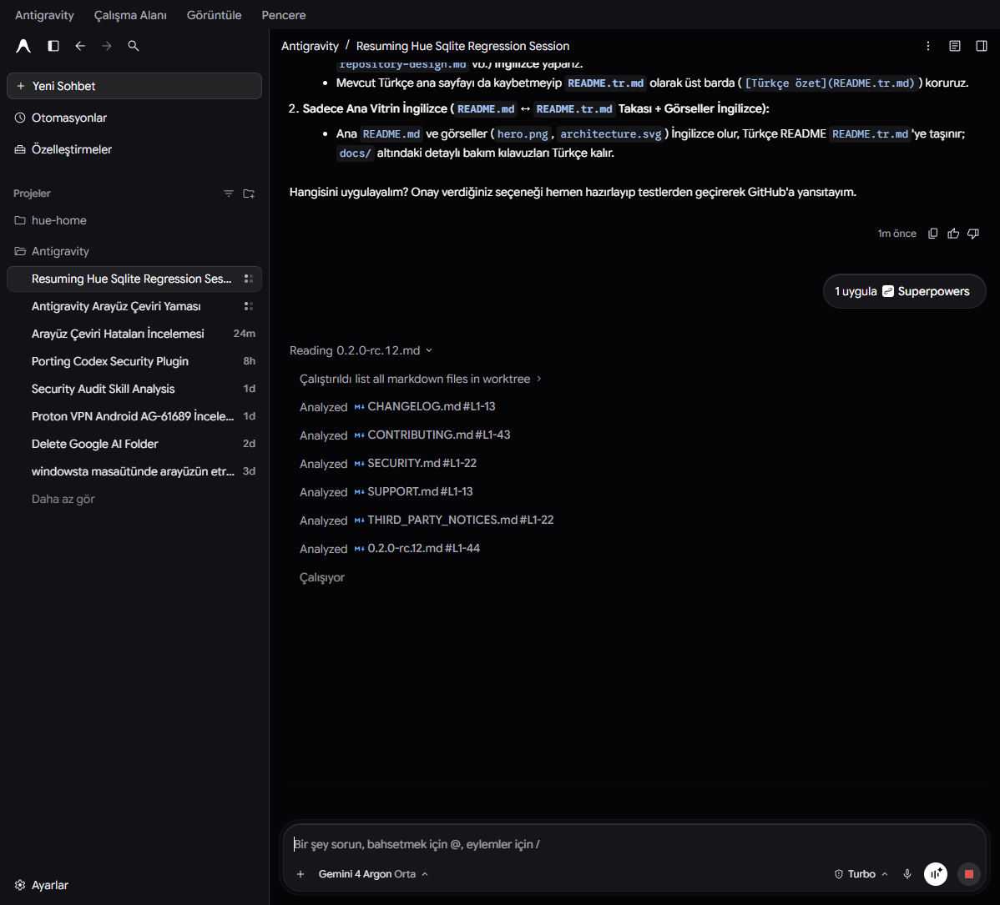
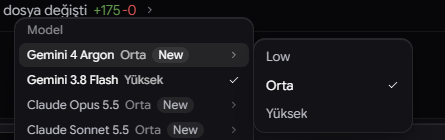
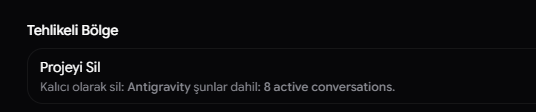
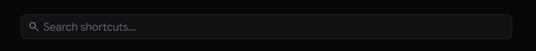

<div align="center">

# 🌐 Google Antigravity 2.0 Türkçe Yama & Otomatik Güncelleme Eklentisi

**Google Antigravity masaüstü yapay zeka arayüzü için kesintisiz, dinamik ve güncelleme-dirençli Türkçe yerelleştirme katmanı.**

[](LICENSE)
[](https://microsoft.com)
[](https://deepmind.google)
[](#)
[](CONTRIBUTING.md)

[Kurulum](#-hızlı-kurulum) • [Özellikler](#-öne-çıkan-özellikler) • [Mimari](#-mimari-akış-şeması) • [Ekran Görüntüleri](#-ekran-görüntüleri) • [Geri Alma](#-kaldırma-uninstallation) • [Katkıda Bulunma](CONTRIBUTING.md)

</div>

---

## 📌 Neden Bu Proje?

**Google Antigravity**, DeepMind ekibi tarafından geliştirilen yeni nesil otonom ajan ve kodlama ortamıdır. Ancak yerel olarak Türkçe dil desteği sunmamaktadır. 

Bu proje;
1. Antigravity 2.0 arayüzünü (Ayarlar, Projeler, İzinler, Modeller, Sohbet Akışı, Otomasyonlar, Menüler) eksiksiz Türkçeleştirir.
2. **Addon Modu (Otomatik Güncelleme Koruyucusu):** Antigravity her güncellendiğinde Electron `app.asar` arşivi sıfırlanır. Bu repo, Windows arka planında dosya değişimlerini izleyerek güncellemeyi saniyeler içinde sessizce yeniden mühürler; çevirileriniz asla kaybolmaz.
3. **Sıfır Performans Kaybı:** Kod blokları (`monaco`, `prism`, `code`) filtrelenir; sadece kullanıcı arayüzü reaktif `MutationObserver` ile çevrilir.

---

## ✨ Öne Çıkan Özellikler

- 🚀 **Tek Tıkla Kurulum:** `Install.cmd` ile yönetici iznine gerek duymadan anında devreye girer.
- 🔄 **Canlı Sıcak Enjeksiyon (Hot-Apply):** Uygulama açıkken dahi yeniden başlatma gerektirmeden CDP üzerinden anında Türkçe'ye dönüşür.
- 🛡️ **Güncelleme Direnci:** Antigravity arka planda kendini güncellediğinde, yerleşik izleyici ASAR mühür kontrolü yapar ve yamayı tekrar uygular.
- 📦 **700+ Terim & Dinamik Regex:** Basit statik metinlerin ötesinde sayılar, süreler (`5s limit`, `%93 kaldı`), çoğul kalıplar dinamik işlenir.
- 🔒 **Güvenli ve Geri Alınabilir:** Orijinal `app.asar` dosyası `app.asar.bak.original` adıyla korunur; `Uninstall.cmd` ile saniyeler içinde fabrika ayarlarına dönülür.

---

## 🏗️ Mimari Akış Şeması

```mermaid
flowchart TD
    subgraph Kurulum [1. Kurulum Süreci (Install.cmd)]
        A["Install.cmd"] --> B["Install-AntigravityTR.ps1"]
        B --> C["Orijinal app.asar Yedeği Alınır"]
        B --> D["build_locale.py -> tr-locale.js Derlenir"]
        B --> E["patch_asar.py -> app.asar Mühürlenir"]
        B --> F["Başlangıç Kaydı (HKCU Run) Eklenir"]
    end

    subgraph Runtime [2. Otomatik Güncelleme Koruyucusu (Addon Modu)]
        F --> G["Watch-AntigravityUpdate.ps1 (Arka Plan)"]
        G -->|Antigravity Güncellendi| H["Ensure-AntigravityTR.ps1"]
        H -->|ASAR Mührü Eksikse| I["patch_asar.py --force (Sessiz Yama)"]
        H -->|Mühürlü ise| J["İzlemeye Devam Et"]
    end

    subgraph Live [3. Çalışma Zamanı Enjeksiyonu]
        E --> K["Electron preload.js Enjeksiyonu"]
        K --> L["Reaktif MutationObserver (DOM)"]
        L --> M["Sıfır Gecikmeli Türkçe Arayüz"]
    end
```

---

## 📸 Ekran Görüntüleri

### Canlı Arayüz Görünümü


<div align="center">
  <table>
    <tr>
      <td width="50%">
        
        <p align="center"><b>Model & Düşünme Seviyesi Menüsü</b></p>
      </td>
      <td width="50%">
        
        <p align="center"><b>Ayarlar ve Tercihler</b></p>
      </td>
    </tr>
    <tr>
      <td width="50%">
        
        <p align="center"><b>Tehlikeli Bölge & Dinamik Sayaçlar</b></p>
      </td>
      <td width="50%">
        
        <p align="center"><b>Kısayollar ve Arama Arayüzü</b></p>
      </td>
    </tr>
  </table>
</div>

---

## 🚀 Hızlı Kurulum

### Yöntem 1: Tek Tıkla Kurulum (Önerilen)
1. Bu depoyu indirin (`Code -> Download ZIP` veya `git clone`).
2. Klasör içindeki **`Install.cmd`** dosyasına çift tıklayın.
3. Kurulum otomatik olarak Python ortamını bulacak, yamayı uygulayacak ve güncelleme izleyicisini başlatacaktır.

### Yöntem 2: PowerShell ile Kurulum
```powershell
# Depo dizininde:
.\Install-AntigravityTR.ps1
```

---

## 🗑️ Kaldırma (Uninstallation)

İstediğiniz zaman tek bir tıklamayla Antigravity'yi orijinal İngilizce sürümüne döndürebilirsiniz:

1. Klasördeki **`Uninstall.cmd`** dosyasını çalıştırın (veya PowerShell'de `.\Uninstall-AntigravityTR.ps1`).
2. Arka plan izleyici kaldırılır ve ilk kurulumdaki `app.asar.bak.original` yedeği yerine konur.

---

## 🛠️ Geliştirici & Manuel Komutlar

Sözlüğü genişletmek veya testleri çalıştırmak için:

```powershell
# 1. Sözlükteki yeni terimleri derleyin:
python build_locale.py

# 2. 12 adımlı tam test paketini çalıştırın:
python test_tr_patch.py

# 3. Canlı açık pencereye sıcak enjeksiyon yapın:
node hot_apply.js

# 4. ASAR bütünlük kontrolü:
python patch_asar.py --check
```

---

## 🛡️ Güvenlik ve Gizlilik

- Bu yama **%100 açık kaynaklıdır** ve tamamen yerel makinenizde çalışır.
- Hiçbir harici sunucuya veri göndermez, telemetri toplamaz veya ağ bağlantısı açmaz.
- Model yanıtlarını, kod bloklarını ve terminal çıktılarını asla değiştirmez.

---

## 📄 Lisans

Bu proje [MIT Lisansı](LICENSE) altında lisanslanmıştır.
Katkılarınız için [CONTRIBUTING.md](CONTRIBUTING.md) belgesini inceleyebilirsiniz.
