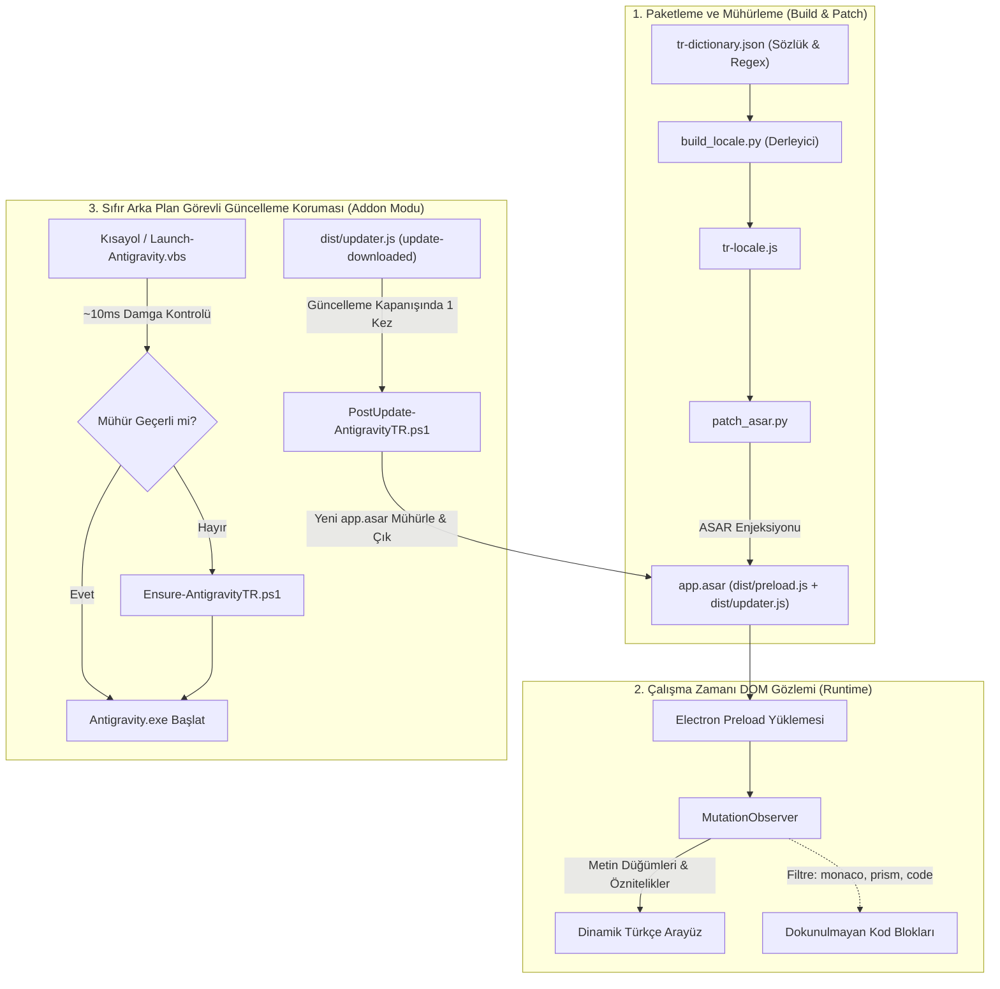
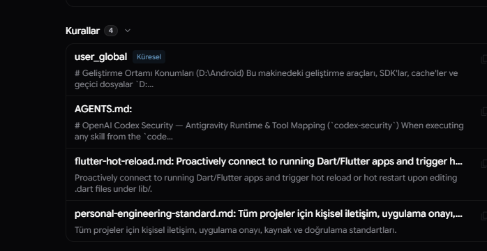
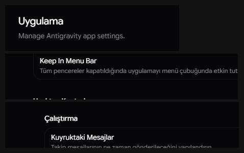

# Google Antigravity 2.0 Türkçe Yerelleştirme ve Güncelleme İzleme Modülü

Bu depo, **Google Antigravity 2.0** masaüstü çalışma ortamı için geliştirilmiş yerelleştirme katmanını, çalışma zamanı dinamik DOM çeviri motorunu ve otomatik sürüm güncellemelerine karşı kalıcılık sağlayan izleme servisini içerir.

[](LICENSE)
[](https://microsoft.com)
[](https://deepmind.google)
[](#doğrulama-ve-test-metodolojisi)

---

## 1. Amaç ve Kapsam

Google Antigravity, Electron tabanlı bir masaüstü yapay zeka arayüzüdür. Uygulama arayüzü varsayılan olarak İngilizce dilinde derlenmekte olup yerel dil desteği içermemektedir. Ayrıca Electron çalışma zamanı mimarisi gereği, uygulama güncellendiğinde paket arşivi (`app.asar`) bütünüyle yeniden yazılmakta ve yerel dosya değişiklikleri sıfırlanmaktadır.

Bu çalışmanın hedefleri:
1. Uygulama arayüz metinlerinin, özniteliklerinin (`placeholder`, `title`, `aria-label`) ve dinamik sayısal/zamansal sayaçlarının performans kaybı yaratmaksızın Türkçe diline dönüştürülmesi,
2. Kaynak kod blokları (`code`, `pre`, `monaco`, `prism`) ile model tarafından üretilen teknik çıktıların bütünlüğünün korunması,
3. Arka planda sürekli bir servis veya izleyici çalıştırmaksızın, uygulama içi güncelleme kancası (`dist/updater.js`) ve hızlı açılış sarmalayıcısı (`Launch-Antigravity.vbs`) üzerinden güncellemeler sonrasında çeviri katmanının otomatik olarak yeniden uygulanmasıdır.

---

## 2. Sistem Mimarisi

Sistem üç temel katmandan oluşmaktadır:



### 2.1. Dinamik Çeviri Motoru (`tr-locale.js`)
- **Seçici Gözlem:** `MutationObserver` nesnesi `document.body` üzerindeki `childList`, `characterData` ve belirli öznitelikleri (`placeholder`, `title`, `aria-label`) izler.
- **Döngü Koruması:** Yeniden tetiklemeleri engellemek amacıyla mutasyon sırasında `isMutating` bayrağı ile re-entry denetimi yapılır.
- **Korumalı Alanlar:** Kod editörleri, markdown gövdeleri ve terminal çıktıları (`monaco-editor`, `markdown-body`, `prism`, `code`, `pre`, `textarea`) çeviri kapsamı dışında tutulur.

### 2.2. Sıfır Arka Plan Görevli Güncelleme Koruması (`dist/updater.js` + `Launch-Antigravity.vbs`)
- Sistem arka planında sürekli bekleyen hiçbir PowerShell veya izleyici süreci çalıştırılmaz.
- **Uygulama İçi Addon Kancası:** `dist/updater.js` içine eklenen kanca yalnızca yeni bir güncelleme indirildiğinde (`update-downloaded`) aktifleşir; uygulama güncelleme kurmak üzere kapanırken tek seferlik `PostUpdate-AntigravityTR.ps1` sürecini başlatır. Bu süreç yeni `app.asar` yazıldığı anda yamayı ve kısayolları uygulayıp derhal sonlanır.
- **Açılış Koruması:** Başlat Menüsü, Görev Çubuğu ve Masaüstü kısayolları görünmez `Launch-Antigravity.vbs` başlatıcısına bağlanır; her açılışta ~10 ms içinde damga doğrulaması yapılır ve yalnızca yama eksikse `Ensure-AntigravityTR.ps1` çalıştırılarak uygulama Türkçe açılır.

---

## 3. Arayüz Bileşenleri

Aşağıdaki ekran görüntüleri, modül tarafından çevrilen genel arayüz alanlarını ve menü yapılarını göstermektedir:

<div align="center">
  <table>
    <tr>
      <td width="50%" align="center">
        
        <p><b>Şekil 1:</b> Menü Çubuğu ve Ana Gezinme Paneli</p>
      </td>
      <td width="50%" align="center">
        
        <p><b>Şekil 2:</b> Model Seçimi, Düşünme Seviyeleri ve Kota Paneli</p>
      </td>
    </tr>
    <tr>
      <td width="50%" align="center">
        
        <p><b>Şekil 3:</b> Ayarlar Kategorileri (Uygulama, Görünüm, Bildirimler)</p>
      </td>
      <td width="50%" align="center">
        
        <p><b>Şekil 4:</b> Kısayollar Penceresi ve Dinamik Arama Alanı</p>
      </td>
    </tr>
  </table>
</div>

---

## 4. Kurulum Prosedürü

### Gereksinimler
- Windows 10 veya Windows 11 (x64)
- Python 3.10 veya üzeri
- Google Antigravity masaüstü uygulaması

### Yöntem A: Otomatik Kurulum (Komut Dosyası)
1. Bu depoyu klonlayın veya arşiv olarak indirin:
   ```powershell
   git clone https://github.com/illetyus/antigravty-turkish.git
   cd antigravty-turkish
   ```
2. `Install.cmd` dosyasını çalıştırın (veya doğrudan PowerShell üzerinden `.\Install-AntigravityTR.ps1`).

Kurulum betiği aşağıdaki adımları otomatik olarak tamamlar:
- `app.asar.bak.original` adıyla fabrika yedeğini oluşturur.
- Güncel sözlük veritabanından `tr-locale.js` modülünü derler.
- ASAR arşivini (`dist/preload.js` ve `dist/updater.js` kancası dahil) mühürler.
- Başlat Menüsü, Görev Çubuğu ve Masaüstü kısayollarını görünmez `Launch-Antigravity.vbs` başlatıcısına bağlar (arka planda sürekli görev çalıştırmaz).
- Antigravity açık durumda ise CDP WebSocket üzerinden canlı oturuma sıcak enjeksiyon uygular.

---

## 5. Kaldırma Prosedürü (Rollback)

Yamayı tamamen kaldırmak ve uygulamayı orijinal fabrika ayarlarına döndürmek için:

```powershell
.\Uninstall-AntigravityTR.ps1
```
veya `Uninstall.cmd` dosyasını çalıştırın.

Bu işlem:
1. Kısayolları orijinal `Antigravity.exe` yedeklerine geri yükler ve varsa eski başlangıç kayıtlarını temizler.
2. `app.asar.bak.original` yedeğini asıl arşivin üzerine kopyalayarak uygulamayı orijinal durumuna getirir.

---

## 6. Doğrulama ve Test Metodolojisi

Modülün kararlılığı ve dosya bütünlüğü `test_tr_patch.py` doğrulama paketi ile denetlenmektedir:

```powershell
python test_tr_patch.py
```

Test Kapsamı:
1. `app.asar` dosya varlığı ve SHA256 blok bütünlüğü denetimi
2. ASAR arşiv yapısının geçerliliği (740+ dosya indeksi doğrulaması)
3. `preload.js` mühür imzasının (`ANTIGRAVITY_TR_PATCH_V1`) varlığı
4. `dist/menu.js` menü girişlerinin çeviri denetimi
5. `dist/tray.js` sistem tepsisi metin denetimi
6. `dist/main.js` sistem iletişim pencerelerinin çeviri denetimi
7. `dist/updater.js` güncelleme bildirimleri ve `ANTIGRAVITY_TR_UPDATER_HOOK_V1` kancası denetimi
8. Geri alma yedeğinin (`backups/`) mevcudiyet kontrolü
9. `tr-dictionary.json` şema ve sözdizimi geçerliliği (727 terim, 58 regex)
10. `tr-locale.js` öznitelik gözlemcisi ve döngü engelleyici (`isMutating`) analizi
11. Sıfır arka plan görevi durumu ve PowerShell betiklerinin sözdizimi denetimi
12. `Ensure-AntigravityTR.ps1` parametre iletim testi
13. Tek seferlik `PostUpdate-AntigravityTR.ps1` koruyucusunun güncelleme simülasyonunda yeniden yamalayıp çıkış yapması
14. `Configure-AntigravityShortcuts.ps1` kısayol sarmalama ve orijinal hedefe geri yükleme testi

---

## 7. Güvenlik ve Gizlilik Bildirimi

- Bu yazılım harici herhangi bir sunucuya ağ bağlantısı kurmaz; telemetri, analitik veri veya kullanıcı günlüğü toplamaz.
- Kullanıcıya ait proje dosyaları, sohbet geçmişi ve API anahtarları yerel dosya sisteminde olduğu gibi korunur.
- Tüm işlemler yerel makine üzerinde, işletim sistemi sınırları dahilinde yürütülür.

---

## 8. Lisans

Bu proje [MIT Lisansı](LICENSE) kapsamında sunulmaktadır.
Katkı kuralları için [CONTRIBUTING.md](CONTRIBUTING.md) dosyasına başvurabilirsiniz.
